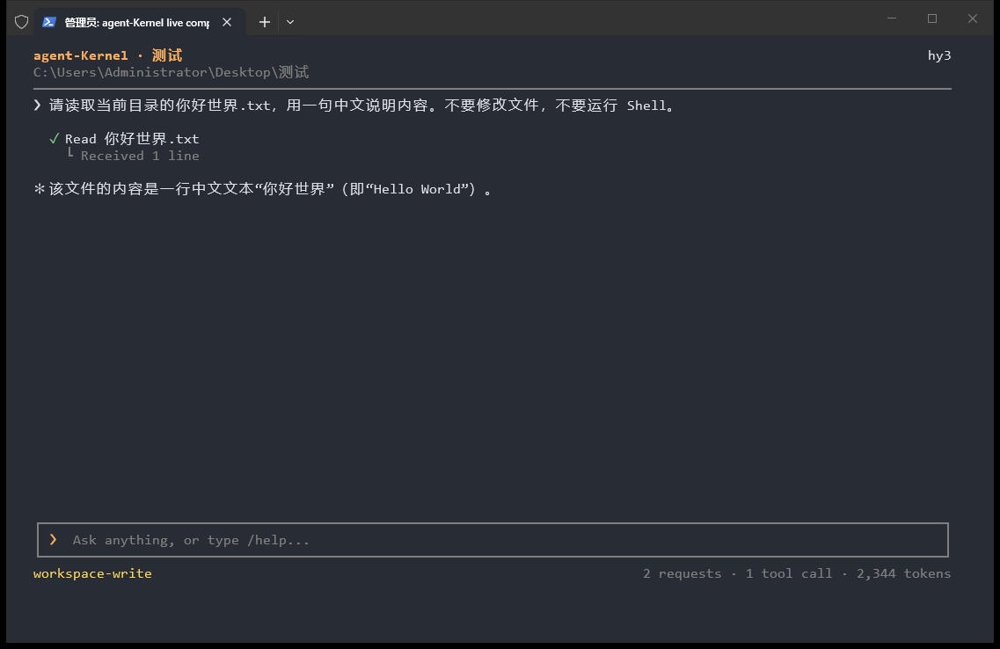
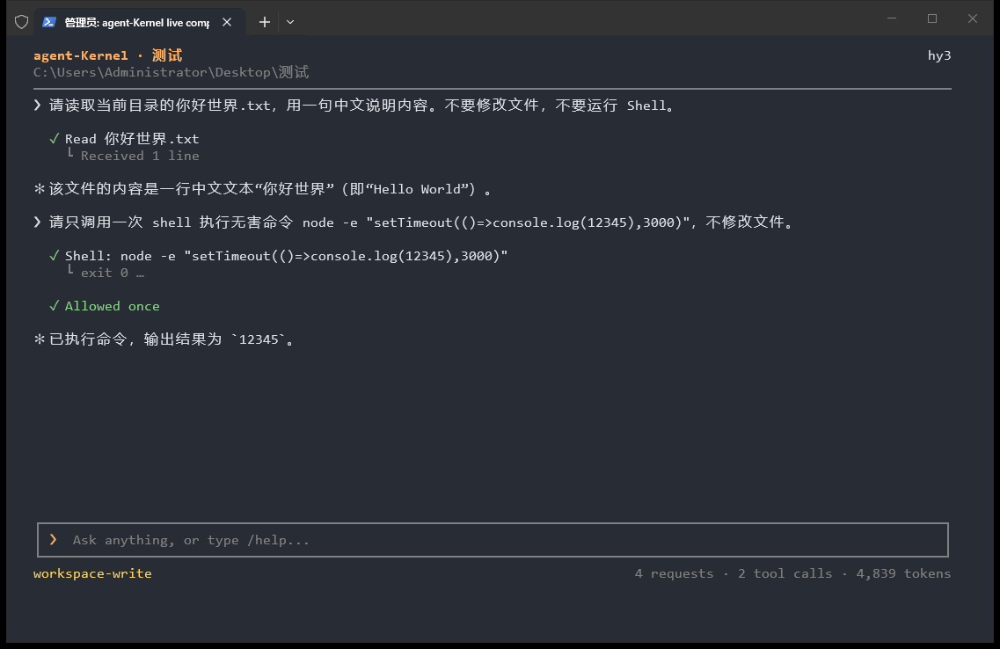

# TUI 实机对照与迭代记录

> **历史记录**：本文件记录的是 2026-11-06 的界面验收；其中 Shell 审批、权限模式与 `y/N` 提示已在 2026-11-12 随 [ADR-0019](../../adr/0019-full-access-is-the-only-mode.md) 删除，截图只作为历史对照。

2026-11-06，Asia/Shanghai。分支 `feat/tui-v0.2`，继续 [PR #9](https://github.com/wwxst/agent-Kernel/pull/9)，不合并。

后续已根据用户截图反馈、同步远端自适应输入改动继续迭代；当前输入分隔线、过程状态及最新验证见[后续实机记录](./tui-feedback-20261106/README.md)。下文保留上一轮实现与验收结果。

## 结果与修改范围

实际启动本机 Claude Code 与 agent-Kernel，在独立测试目录观察界面，完成两轮 UI 修改、重启与真实窗口截图复测。只改 `src/tui.ts`、`test/tui.test.mjs` 和 UI 文档，没有修改 Kernel、LLM、Prompt、Permission、ToolRegistry、Transcript、Session 或统计逻辑，没有增加运行时依赖。

| 实机发现的问题 | 修改及复测结果 |
| --- | --- |
| 用户整段正文和完整输入边框都亮橙色，抢占正文与工具状态的注意力 | 用户改为中性粗体；日常输入边界改为灰色，审批期间才强调。标题和输入符号保留少量强调色 |
| 在 `测试` 这样的目录启动时，标题只有目录名，无法辨认程序 | 显示 `agent-Kernel · 测试`，右侧保留模型，下一行保留真实工作目录 |
| 回答后仍保留大审批框和 `Allow this command?`，挤走对话，像仍待授权 | 待审批时完整展示命令与 cwd，可翻阅；回答后收起面板，保留决定和工具结果。拒绝改用权限拒绝符号和黄色 |
| 无害命令 `node -e "process.exitCode=7"` 实际返回 `exit 7`，却显示成功 | Shell 非零退出、超时、执行中取消、无退出码显示失败，保留原始结果；`exit 0` 和读取内容为 `exit 7` 的文件仍是成功 |

代码提交：`a87682ff69c7be082bdcce1e803b37760dad2d60`（Shell 状态）、`6d0e3197086e4e98b89bf528dfe4c12e4a7bc4fb`（视觉层次、收起已结束审批）。初始基线 `dfb85c18242ec6dbc620e0809ed67f5bc054be4c`。`before` 图片已包含第一项 Shell 状态修复，用于对比第二轮视觉调整。

## 实际环境与方法

- 测试目录 `C:\Users\Administrator\Desktop\测试`，源码始终位于 `E:\JavaProjects\web-project\agent-Kernel`。从源码目录的 `.env` 启动实际 CLI，进程 cwd 为测试目录。该目录仍只有原有的 `你好世界.txt`，13 字节；没有执行破坏性操作。
- Windows Terminal portable `1.25.2733.0`，ProductVersion `1.25.260930003`，Microsoft 签名 Valid。两个程序使用同一临时配置：One Half Dark、Consolas 12pt、padding 12、初始 120×35；另做 80×24 与更窄窗口的实际 resize。
- 两边均运行于 Windows PowerShell 5.1；Claude Code `2.1.318`，两边实际模型均为 `hy3`。Claude 以 `--permission-mode manual` 启动观察审批，没有选择永久授权。
- Claude 初次请求确实失败；用户修复本地配置后，重新启动已成功读取中文文件、执行无害命令、显示审批/拒绝和长回复。截图仍有自定义模型名无法识别的警告，但实际请求成功。未修改 Claude 安装文件、持久设置或内部实现。
- 传统 PowerShell 为独立 conhost，80×24，屏幕缓冲宽度也设为 80；保留蓝色背景，使用 ASCII 与 `NO_COLOR`。没有以伪造的 `WT_SESSION` 将 conhost 称为 Windows Terminal。
- PNG 通过 Win32 `PrintWindow` 获取，包含真实窗口标题栏，没有拼接、重绘、HTML 模拟或 mock 回答。输入及 resize 通过目标终端输入/窗口 API 完成，每轮修改后重启实际 CLI 再截图。
- 沿用计划、TDD、验证后完成与双轴审查流程。新增回归先确认失败，再做最小 UI 修改；直接执行用户已授权的 UI 迭代。

## 真实截图对照

所有原图位于 [tui-live-20261106](./tui-live-20261106/)。

| 场景 | Claude Code | agent-Kernel |
| --- | --- | --- |
| 启动 | [启动](./tui-live-20261106/claude-start.png) | [修改前](./tui-live-20261106/agent-start-before.png)、[修改后](./tui-live-20261106/agent-start-final.png) |
| 同一中文文件、短回复 | [短回复](./tui-live-20261106/claude-short.png) | [修改前](./tui-live-20261106/agent-short-before.png)、[修改后](./tui-live-20261106/agent-short-final.png) |
| 等待 | [Thinking](./tui-live-20261106/claude-thinking.png) | [Thinking](./tui-live-20261106/agent-thinking-final.png) |
| Shell 审批 | [审批](./tui-live-20261106/claude-approval.png) | [修改前](./tui-live-20261106/agent-approval-before.png)、[修改后](./tui-live-20261106/agent-approval-final.png) |
| 工具执行 | [执行中](./tui-live-20261106/claude-tools.png) | [执行中](./tui-live-20261106/agent-tool-running.png)、[成功](./tui-live-20261106/agent-tools-final.png)、[Shell 非零退出](./tui-live-20261106/agent-shell-failure.png) |
| 拒绝 | [拒绝](./tui-live-20261106/claude-denied.png) | [旧面板残留](./tui-live-20261106/agent-denied-before.png)、[回答后收起](./tui-live-20261106/agent-denied-final.png) |
| 文件不存在 | [错误](./tui-live-20261106/claude-error.png) | [错误与 80 列重排](./tui-live-20261106/agent-resize-80.png) |
| 用户给定任务 | [目录说明](./tui-live-20261106/claude-directory.png) | [目录说明](./tui-live-20261106/agent-directory.png) |
| 45 行中文/English | [长回复](./tui-live-20261106/claude-long.png) | [长回复](./tui-live-20261106/agent-long.png)、[翻历史保留草稿](./tui-live-20261106/agent-scroll-draft.png)、[缩窄保留草稿](./tui-live-20261106/agent-resize-draft.png) |
| 多行长命令 | — | [BEGIN、长参数与 TAIL](./tui-live-20261106/agent-long-approval-tail.png)、[PageUp](./tui-live-20261106/agent-long-approval-pageup.png)、[审批 Ctrl-C 返回 Shell](./tui-live-20261106/agent-approval-cancelled.png) |
| 传统 PowerShell | — | [启动](./tui-live-20261106/classic-start.png)、[中文短回复](./tui-live-20261106/classic-short.png)、[EOF 返回 Shell](./tui-live-20261106/classic-eof.png)、[审批](./tui-live-20261106/classic-approval.png)、[审批 EOF 默认拒绝](./tui-live-20261106/classic-approval-eof.png) |

同一短任务为 `请读取当前目录的你好世界.txt，用一句中文说明内容。不要修改文件，不要运行 Shell。`，两边均成功。另分别提交原始任务 `可以读取并修改当前目录中的文件，说明目录结构，可以当前目录修改任何文件，可以运行 Shell 命令。`，两边均返回目录说明。

Shell 对照使用 `node -e "console.log(12345)"`，执行中截图另用 3 秒定时输出。agent-Kernel 分别允许一次与拒绝，下一条命令仍重新询问。长命令有两行，第一行包含 BEGIN 和约 1500 个 `x`，第二行包含 TAIL，没有执行该长命令。审批 EOF 实际结果明确写出 `approval prompt closed; denied by default`，没有冒充用户选择拒绝。

最终短会话：

回答后的工具记录：

## 测试与双轴审查

| 项目 | 本轮结果 |
| --- | --- |
| `npm run check` | strict typecheck 通过；256 tests，249 pass，7 skipped，0 fail（本机 Windows） |
| TUI 测试 | 44/44；新增 4 项先红后绿回归 |
| `npm run eval:check` | 20/20 |
| Standards | 独立只读审查 `dfb85c1...6d0e319`，0 项实质违反；独立重跑 TUI 44/44 |
| Spec | 无阻断性代码问题；配色说明未同步这一项已更新 `tui-v0.3-layout-spec.md` |
| 本轮 diff 范围 | 仅 TUI、UI 测试、UI 规范及截图/报告；无 Kernel 或权限执行逻辑改动 |
| GitHub CI | 本报告提交后的精确 head SHA、Linux / Windows 结果与 run 链接，统一记录于 [PR #9 的 Evidence](https://github.com/wwxst/agent-Kernel/pull/9)，不使用旧提交绿灯代替最终 head 检查 |

7 项本机跳过包含 Linux PTY 专属用例、Windows 无法由 Node 向另一进程投递 SIGINT 的用例和文件权限读取限制用例；不把跳过计为本机成功。控制字符转义、排队输入、默认拒绝、取消、resize、颜色降级等原有自动回归仍通过。

## 仍保留的差异与验证边界

- 本机 Claude 的输入区随短对话向下流动；agent-Kernel 按任务要求固定在底部。两者不逐像素相同。
- 保留自己的符号与权限规则，不复制 Claude 品牌、永久授权、自动模式、工具折叠、Slash 菜单或子代理功能。
- Markdown 仍按可读纯文本展示，代码围栏与行内反引号不会完整渲染成 Claude 样式；未增加 Markdown 框架。
- 中文文件名、正文、草稿与 resize 已在真实窗口检查。文本通过 Unicode 键盘/控制台输入注入，**原生中文 IME 候选框和组合态未验证**；复杂 emoji / ZWJ 宽度仍为近似值。
- 多行长命令有实拍；含终端控制码、双向控制符的审批只做了自动回归，本轮没有对应真实模型审批截图。
- Thinking 切换、流式增量、历史翻页与输入区域隔离已观察；未量化测量帧率或闪烁。保留 2000 条逻辑行上限、单行输入与终端最小尺寸降级。
- 没有修复非 UI 行为。最初 Claude 连接问题由用户修复，不列为 TUI 修复成果。
