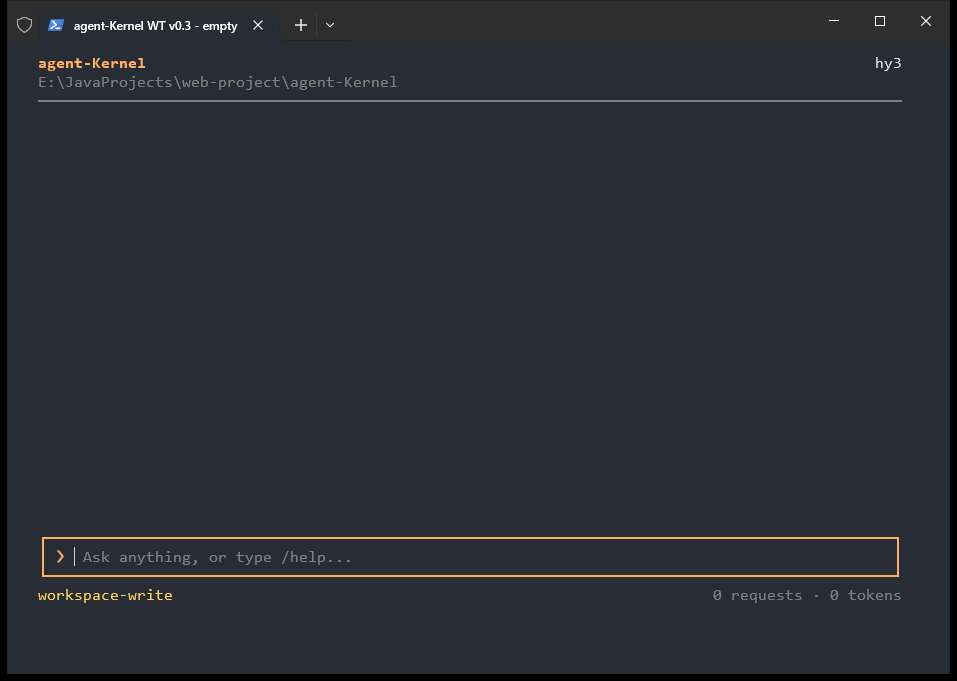
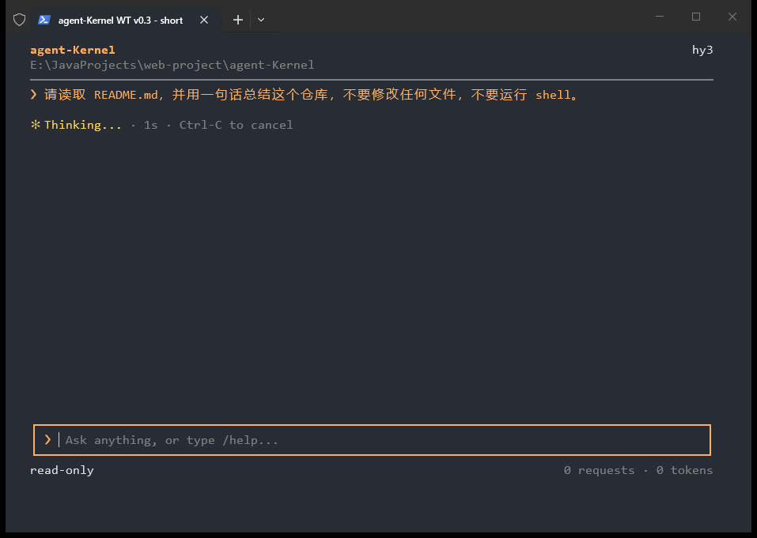
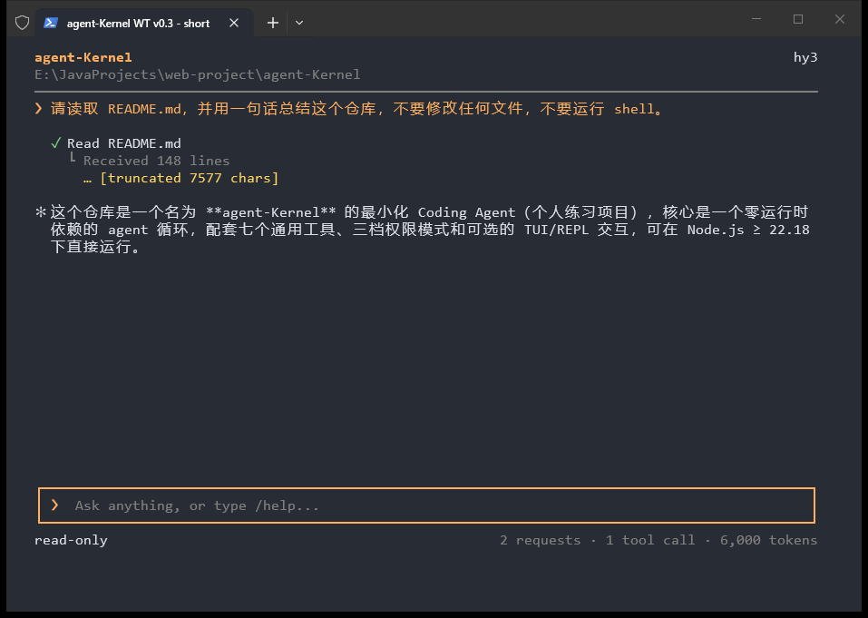
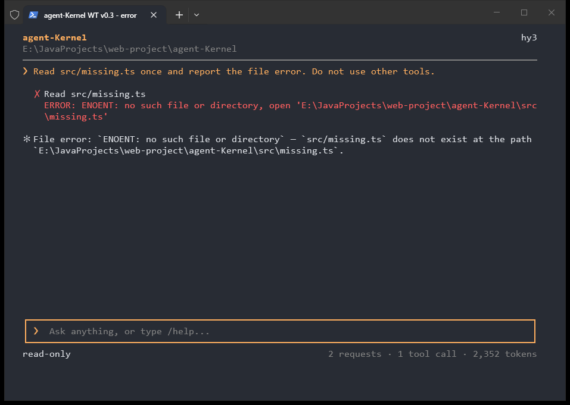
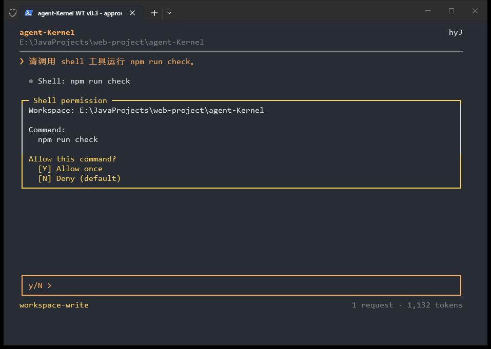
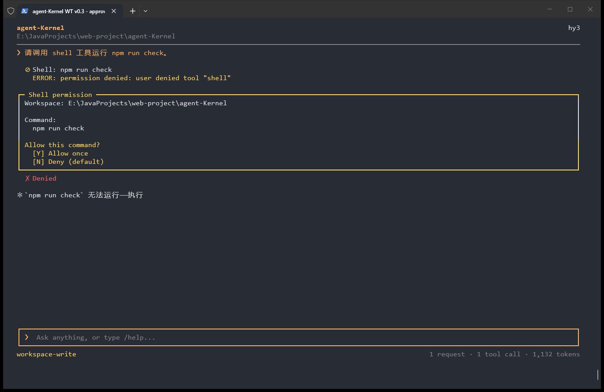
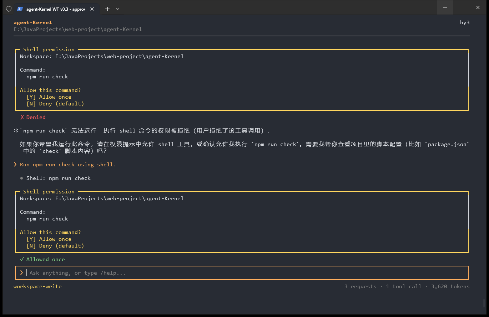
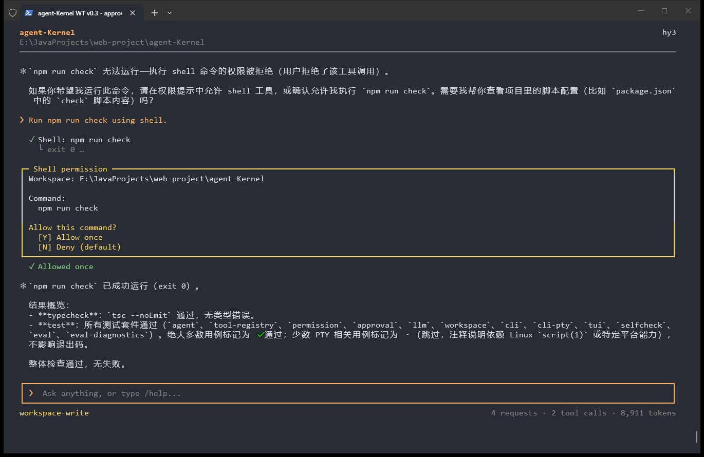

# Windows Terminal 实际截图与逐图对照验收

> **历史记录**：本文件记录的是 v0.3 的界面验收；其中 `--permission read-only`、Shell 审批与拒绝提示已在 2026-11-12 随 [ADR-0019](../../adr/0019-full-access-is-the-only-mode.md) 删除，截图只作为历史对照。

2026-11-06，Asia/Shanghai。继续更新 [PR #9](https://github.com/wwxst/agent-Kernel/pull/9)，不合并。

本轮先逐张打开 [7 张 Claude Code 真实截图](../../claude-code-ui-references/README.md) 的原始 PNG，再按 [v0.3 布局规范](../../tui-v0.3-layout-spec.md) 改动。逐图观察与取舍见 [对照记录](../../tui-reference-polish-plan.md)。第三方图片只在临时目录中查看，未二次分发到仓库。

## 实际环境

- Windows 10 22H2（10.0.19045）。
- 真正的 **Windows Terminal v1.25.2733.0 portable**；二进制 ProductVersion `1.25.260930003`，Microsoft Corporation 签名校验为 Valid。
- 来自 [微软官方发布](https://github.com/microsoft/terminal/releases/tag/v1.25.2733.0)，按 [官方 portable 说明](https://learn.microsoft.com/en-us/windows/terminal/distributions#enabling-portable-mode) 在临时目录运行。
- 独立临时设置：One Half Dark，Consolas 12pt，padding 12，初始 100×32；部分审批交互截图在窗口放大后获取。主题由终端设置，不是 TUI 设置背景。
- Terminal 内运行 Windows PowerShell 5.1，启动实际 CLI：`node --env-file-if-exists=.env src/cli.ts --tui`。`WT_SESSION` 由 Windows Terminal 注入，未用它把 conhost 伪装成 Windows Terminal。
- 模型是实际配置的 `hy3`，通过真实 Tool call 读取本仓库文件/请求 Shell。没有用静态 HTML、绘图或 mock 回复代替产品画面。
- 所有 PNG 都是原生 Windows Terminal 窗口的 PrintWindow 原始截图，包含实际标签栏；逐张查看确认后保留，未拼接、未重绘。

## 截图与行为

空会话：简洁 Header 位于顶部，中间空白，输入框与 Permission / 统计行位于底部。

请求开始后实拍 Thinking：实际等待约 1 秒，主提示为强调色，时长与 Ctrl-C 操作为次要文字；输入框仍存在。秒数只量测请求等待，不展示模型内部思考。

固定任务：`请读取 README.md，并用一句话总结这个仓库，不要修改任何文件，不要运行 shell。` 使用 `--permission read-only`。用户、工具结果和回答从顶部向下排列。成功只突出绿色符号，工具名称为中性粗体，下一行显示返回行数；实际读取发生截断，尾注明确保留。

文件错误：实际读取 `src/missing.ts` 后出现失败符号和红色完整原因，工具标题保持可读；错误与模型说明分别显示。

Shell 审批：原始命令 `npm run check`、实际 cwd、中性命令正文、强调的授权选项和 `[N] Deny (default)` 均可见；输入框明确 `y/N >`。

输入 `n` 后，Tool result 使用权限拒绝符号与黄色原因，和文件读取失败的红色区分；独立决策记录保留 Denied。此图捕获于模型回复的流式阶段。

同一 Session 再次请求运行检查，重新询问后输入 `y`。实际执行期间仍显示运行中符号；输入恢复为普通聊天框，没有继续显示 y/N。

实际检查结束：同一 Tool call 的状态替换为成功，缩进子行显示 `exit 0`；Allowed once 明确表明只授权本次，没有持久授权。

## 验证结果

- `npm run check`：strict typecheck 通过；252 tests，245 pass，7 skipped，0 fail（本机 Windows / Node 24.13.1）。
- `npm run eval:check`：20/20。
- TUI 用例 40/40；强制 Unicode 路径的全量 check 同样通过。独立评审使用 CI 相同的 Node 22.18.0 运行 TUI 用例，40/40 通过。
- 本轮新增 4 项回归，先确认失败再修复：工具状态/标题/结果层次、Thinking 时间与停止、审批默认拒绝及输入上下文恢复、错误/非流式回复清除等待。
- 原有长输入、PageUp/PageDown、resize、超长/多行/控制字符审批、默认拒绝、EOF、取消与无 TTY 回归继续通过；远端 Linux / Windows CI 最终状态见 PR 当前 head 的 checks。

## 显示边界

- 这次已验证真实 Windows Terminal 的空会话、短回复、Thinking、工具失败和成功、单行 Shell 允许/拒绝；此前 conhost 的截图和范围保留在 [上一轮记录](../tui-v0.3/README.md)。
- 原生中文 IME 候选框/组合态，以及复杂 emoji/ZWJ 宽度仍未进行人工验收；宽度计算仍是近似值。
- 多行/超长/含控制字符审批有自动回归，本轮现代终端截图使用单行命令；复杂审批在 Windows Terminal 中的人工视觉验收未验证。
- 真实 Windows Terminal 的 Ctrl-C / EOF 人工验收未验证；自动回归与 Linux 真实 PTY 测试继续覆盖。
- 不加入持久权限规则、Slash 命令选择菜单、鼠标、多行输入或 Hooks；仅采用参考图中的层次和就近提示原则。
