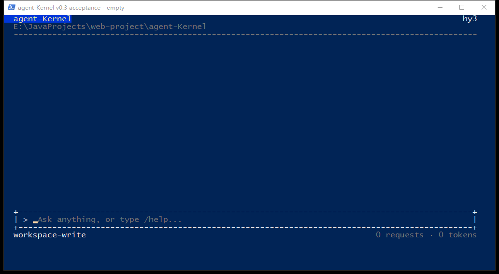
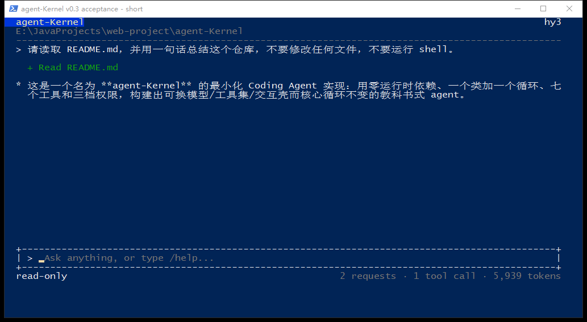
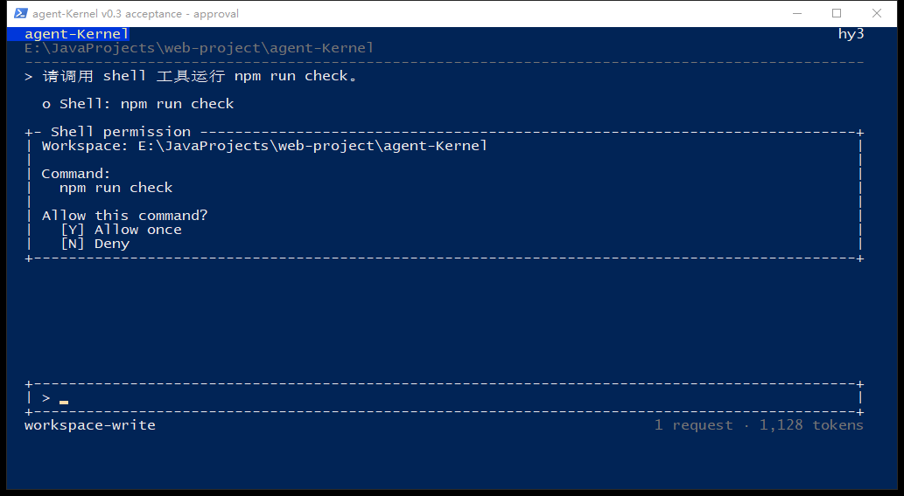
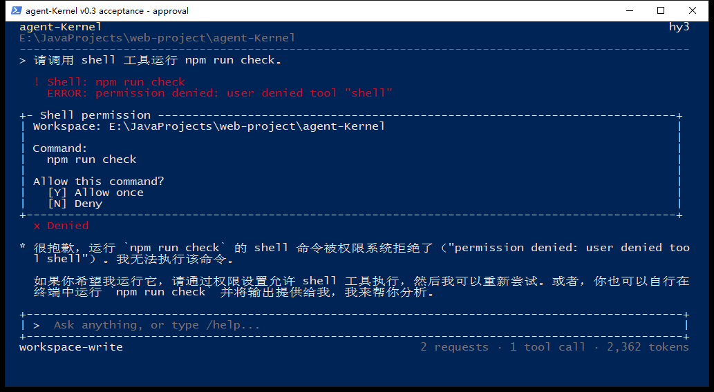
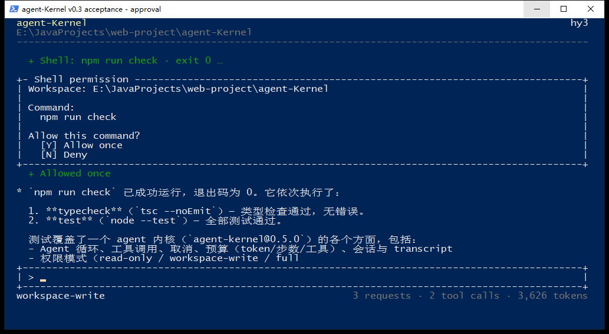
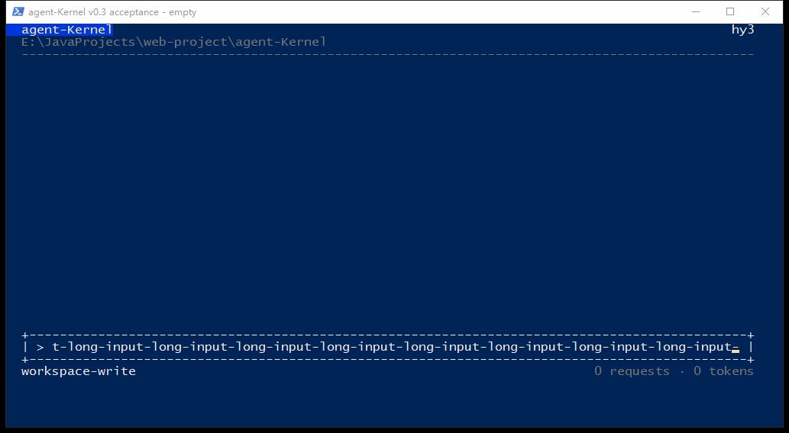
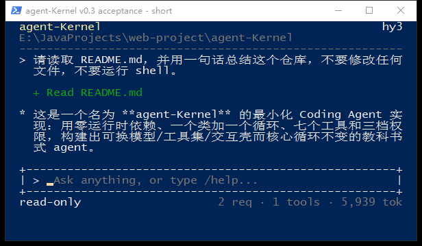
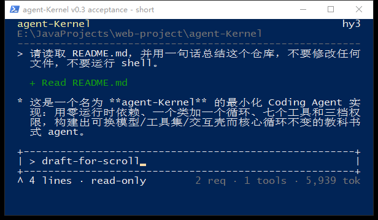

# TUI v0.3 真实终端验收

此页保留上一轮 conhost 的历史验收范围。后续已在真正 Windows Terminal portable 中补充验收，见 [现代终端截图与逐图对照记录](../tui-v0.3-windows-terminal/README.md)。

日期：2026-11-06（Asia/Shanghai）。对应 [布局规范](../../tui-v0.3-layout-spec.md)，PR [#9](https://github.com/wwxst/agent-Kernel/pull/9)，分支 `feat/tui-v0.2`。

## 环境与截图来源

Windows PowerShell 5.1，传统 conhost，100 × 32 字符；缩放场景为 60 × 20。使用 PowerShell 传统深蓝背景与终端默认配色、ASCII 字形；背景来自终端配置。程序没有设置终端主题。

截图为真实 `node --env-file-if-exists=.env src/cli.ts --tui` 窗口的原始 PrintWindow 捕获，包含系统标题栏，未经重绘或拼接。模型为实际配置的 `hy3`，短回答确实经过 `read` 工具读取本仓库 README；不是静态 UI 样例或 mock 回复。截图中的 Token usage 只对应那次实际 Session。

键盘与窗口测试通过 Windows 原生 Console 输入记录和窗口尺寸 API 驱动真实 readline / conhost，逐张查看截图。没有把假流单测当成真实终端验收。

## 实际窗口

空会话：头部在顶部，输入上下边界与状态行在底部，没有启动 help。

固定任务：`请读取 README.md，并用一句话总结这个仓库，不要修改任何文件，不要运行 shell。` 使用 `--permission read-only`。用户、工具结果和短回答由上往下排列，空白在下方；正文续行对齐。

Shell 审批：`npm run check` 的实际命令、实际 cwd 与允许一次/拒绝选项完整展示。

输入 `n`：显示独立拒绝符号和 Tool result 的权限原因，未把拒绝显示成执行失败。

同一 Session 再次请求运行检查，输入 `y` 后显示 `Allowed once`，实际 Shell 返回 `exit 0`；这次需要重新询问，没有复用前一条命令的答案。

165 字符输入：显示光标附近的末段，输入仍在单行框内，右边框和状态行完整。

60 × 20：中文、英文与路径重新排版；边框没有越界。

执行 `/help` 后，输入草稿并 PageUp：旧消息可见，草稿保留，状态行标明滚动偏移；PageDown 和放大窗口后仍保留草稿。

## 自动验证

- `npm run check`：strict typecheck 通过；248 tests，241 pass，7 skipped，0 fail。跳过项是 Windows 不适用的 Linux PTY / POSIX 权限测试。
- `node --test test/tui.test.mjs`：36/36 通过。
- 强制 `WT_SESSION=unicode-verification` 后重复运行 TUI 测试：Unicode 路径 36/36 通过。Linux CI 首轮指出旧审批断言只接受 ASCII `|`，现已改为同时接受 `│`；没有改动命令内容断言。
- `npm run eval:check`：20/20。
- 增加 14 项 TUI 回归，均先运行旧行为确认失败，再实现修复：长输入、编辑光标、输入期间输出、正文留白/缩进、审批 resize、超日志上限审批、窄屏降级/恢复、窄屏统计、工具去重、窄屏启动草稿、Tab、窄屏开始审批、CR/Tab/bidi 转义、窄屏 Thinking 与工具切换、`TERM=dumb`。部分相关行为共用一个用例。
- 审批 y/yes、默认拒绝、EOF、取消和无 TTY 由原有审批/CLI 测试继续覆盖；单行 Shell 的真实允许一次和拒绝已截图。Linux/Windows CI 的最终结果以 PR 当前提交的 checks 为准。

## 已知边界与未验证项

- Windows Terminal / VS Code 终端：本机未安装 Windows Terminal，没有进行这两个环境的人工验收，标记为**未验证**。Unicode / ANSI 路径有单元测试，不能替代实际终端截图。
- 原生中文 IME 的候选框与组合态交互：**未验证**。实现继续由 readline 接收输入，滚动和重绘只读取其缓存，不重置编辑器。
- 多行、超长和含控制字符的审批有自动回归；本次真实窗口截图使用单行 `npm run check`，这些复杂审批的人工视觉验收**未验证**。
- 真实 Ctrl-C / EOF 在本次 conhost 窗口中的人工验收**未验证**；自动用例覆盖取消/EOF，Linux CI 另有真实 PTY 测试。
- Run log 保留最近 2000 条逻辑行；待审批原始 request 独立保留，回答前不会因该上限丢掉命令开头。超过视口的审批须 PageUp/PageDown 查看。
- 显示宽度为近似 Unicode 宽度，复杂 emoji / ZWJ 字素可能偏一列；没有鼠标、多行输入和完整终端 scrollback。

PR 保持打开，不自动合并。
